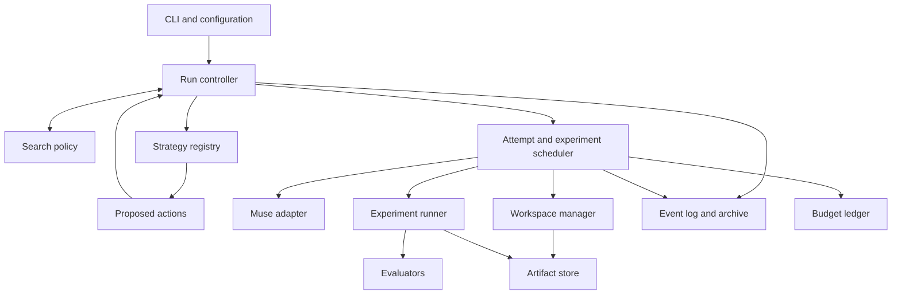

# BranchPilot: architecture proposal

Design date: October 29, 2026. Scope: architecture and contracts; no application implementation or live Muse execution yet.

Build a local TypeScript application with one run controller, a shared scheduler, replaceable search strategies, and a Muse adapter. The durable unit of search is a **candidate revision with evidence**. A Muse session is an execution resource. This keeps code repair, benchmark optimization, and idea exploration in the same system without forcing an idea to begin as a repository patch.

The first working slice is deliberately small: freeze an input, evaluate its baseline, run one Muse turn in an isolated workspace, evaluate the resulting snapshot with the same external evaluator, and persist a readable result. Everything else builds on those records.

## 1. Module boundaries and dependency direction



These boxes are in-process modules, not network services. Start with one Node process coordinating owned worker processes, one controller writer per run, and local files. One managed Muse host per writable workspace is the initial isolation choice; consecutive attempts may reuse that host and session. Do not share a host across unrelated writable branches until its isolation behavior is verified.

| Module | Owns | Dependencies |
|---|---|---|
| `domain/` | Task, run, candidate, revision, evidence, action and lifecycle contracts | No SDK, process or filesystem imports |
| `application/controller` | Lifecycle, acceptance, baseline, action validation, switching, final selection | Domain and service ports |
| `search/policy` | Fixed or automatic strategy choice with a reason | Read-only development evidence and budget view |
| `search/strategies` | Direct, retry, best-of-N and bounded tree proposals | Domain and read-only search view |
| `execution/scheduler` | Reservations, dependency ordering, concurrency, work ownership, stopping and recovery | Backend, workspace, experiment, ledger and persistence ports |
| `adapters/muse` | Host process, SDK lifecycle, sessions, turns, event translation and compatibility | `@muse-code/sdk`, domain ports |
| `execution/workspaces` | Exclusive writer leases, snapshot materialization and capture | Filesystem/Git and artifact port |
| `execution/experiments` | Procedure execution, limits, output collection and stop receipts | Process supervisor and workspace/artifact ports |
| `evaluation/` | Interpret outputs, classify correctness and evidence, compare compatible metrics | Domain only; external execution goes through scheduler |
| `storage/local` | Append log, content-addressed artifacts and rebuilt projections | Filesystem and domain |
| `reporting/` | Findings, tradeoffs, spending and replay | Durable records; never live SDK state |
| `cli/` | Parse config, show progress and collect human input | Application API; composition root wires concrete adapters |

Implementation imports point inward: concrete adapters implement application ports; the controller does not import the Muse package. Strategies return data and receive no process-launch, backend or ledger-mutation handles. The controller revalidates every proposed action against the latest sequence and strategy epoch before the scheduler executes it. A stale proposal is recomputed.

Keep the six configuration dimensions separate:

| Dimension | Decision |
|---|---|
| Task | Frozen goal, inputs, constraints, objectives and evaluator definitions |
| Backend | `muse` initially; the rest of the domain does not contain Muse classes |
| Model / effort | Independent requested settings, resolved from host capabilities |
| Strategy | How candidate work is proposed |
| Policy | Whether and when to choose a different strategy |
| Budget | Cumulative resources and admission rules for the entire run |

`normal` is a CLI alias for fixed policy plus `direct`: exactly one agent attempt followed by external evaluation, in addition to the baseline evaluation. It is not a model or effort level. `auto` begins with `direct`; an incompatible initial strategy is a configuration error. Model/effort defaults are resolved at preflight and changes are explicit, logged configuration events. Strategy changes do not silently increase effort.

## 2. Core contracts and execution invariants

The proposed, standalone TypeScript contracts are in [contracts.ts](./contracts.ts). The examples in [config-examples.ts](./config-examples.ts) are checked against `RunConfig`. Neither file imports or imitates SDK types. This design intentionally adds `CandidateRevision` and `OperationRecord` to the brief's entities: the first binds evidence to immutable content; the second makes uncertain external operations recoverable.

| Entity | Meaning and invariant |
|---|---|
| `TaskSpec` | Authoring configuration. Resolve paths and freeze contents, constraints, evaluator definitions and environment into the run manifest before work. Editing these later starts a new run. |
| `Run` | Stable run ID, resolved configuration, current phase, strategy epoch and one cumulative budget. Strategy changes are events, not new runs. |
| `Candidate` | A line of inquiry with stable identity, parent **revision** IDs, current revision pointer and archive disposition. It may have no code. |
| `CandidateRevision` | Immutable proposal, assumptions and optional checkpoint. A new revision never inherits a previous revision's passing results. |
| `Attempt` | One scheduled agent turn developing one candidate from a named revision. Follow-up turns are new attempts, even when they reuse a session. |
| `Checkpoint` | Immutable file manifest plus a completed conversation boundary and handoff, or a handoff alone. A Git commit by itself is insufficient. |
| `Experiment` | One approved procedure on a specific revision/snapshot, with environment, bounds and raw outputs. Includes bounded repetitions; each repetition is retained. |
| `EvaluationResult` | Interpretation of one experiment: validity, checks, metrics, uncertainty, findings and evidence provenance. |
| `Decision` | Proposed actions or strategy transition, rationale, supporting evidence, sequence and epoch. Persist before effects. |
| `OperationRecord` | Immutable intent and dispatch/receipt state for one external operation, separate from a candidate or session. |

Generate opaque IDs centrally; use UUIDv7 where a protocol requires it. Hash all artifact bytes and record their sizes. A candidate's parent edges form an acyclic graph; do not infer lineage from session IDs. A failed experiment remains in the archive with its falsified prediction or unresolved question. Pruning stops allocation, not retention.

An example lineage is `candidate A / revision A1 (proposal) → attempt 1 → A2 (prototype) → experiment E1`. A retry produces A3 under candidate A. A different approach creates candidate B from A2 and gets its own attempt/workspace. E1 remains evidence for A2 only. Reports can show that a proposal was promising before a later implementation failed.

### The adapter boundary and the real Muse surface

The `CodingBackend` methods in our contract—`discover`, `open`, `submit`, `observe`, `respond`, `requestCancel`, `reconcile`—are **BranchPilot ports**. Map them to the actual SDK inside the adapter; never present them as SDK exports.

| BranchPilot responsibility | Documented Muse surface and design implication |
|---|---|
| Managed connection | `spawnMspConnection({ command, args: ["serve"], cwd })`, then `handshake.initialize(...)` before requests. Save server identity, schema fingerprint and durability. [Quickstart](https://meta-models.github.io/muse-code-sdk/next/guides/quickstart/) |
| Session ownership | `MuseClient` accepts a connection; `startSession` and `resumeSession` return sessions. Its `spawn` helper is also documented. Use one owner for notification routing. Wire constructor options against the pinned declarations. [MuseClient](https://meta-models.github.io/muse-code-sdk/next/generated/sdk/museclient/) |
| Turn submission and interaction | `Session.sendUserTurn` returns a turn handle; `onApproval` and `answerUserInput` support interaction. Persist interaction requests and responses, and observe settlement. [Session](https://meta-models.github.io/muse-code-sdk/next/generated/sdk/session/) |
| Streaming and completion | Turn handles expose `items()`, `deltas()` and `completed`. Durable results come from observed outcomes; streamed text is not acceptance evidence. [Turn](https://meta-models.github.io/muse-code-sdk/next/generated/sdk/turn/) |
| Model discovery | Use `model/list`; inspect provider/model identifiers and supported effort variants. Unknown, absent or empty choices remain explicit. Confirm settings through host records/readback, not command acknowledgement. [Model discovery](https://meta-models.github.io/muse-code-sdk/next/cookbook/list-models-and-switch-mid-session/) |
| Cancellation | `turn/cancel` requests stopping. Await the turn outcome; a completion racing cancellation can legitimately win. Treat `already_terminal` narrowly. [Cancellation](https://meta-models.github.io/muse-code-sdk/next/cookbook/cancel-a-running-turn/) |
| Optional conversation fork | `session/fork` copies history through a completed turn. Its documented parameters do not establish file cloning or workspace relocation. Keep it disabled until verified. [Fork contract](https://meta-models.github.io/muse-code-sdk/next/generated/msp/methods/session-fork/) |
| Command identity | Persist and reuse the same command ID and unchanged payload for a transport retry. New intent needs a new ID. [Idempotency recipe](https://meta-models.github.io/muse-code-sdk/next/cookbook/retry-without-double-submitting/) |
| Host failure | Read the advertised durability profile and SDK discharge behavior. Durable state can be reconciled by resumption; ephemeral or unrecognized durability cannot be assumed recoverable. [Host recovery](https://meta-models.github.io/muse-code-sdk/next/cookbook/survive-the-host-dying/) |

The referenced `/next/` documentation is a design reference, not a version pin. Create a compatibility lock from an actual tested SDK/binary pair: exact package version and lockfile integrity, binary version and SHA-256, protocol fingerprint, feature results and test date. Persist that lock's digest and observed identity in every run. Do not choose a version number from documentation examples. The TypeScript SDK can warn rather than reject a fingerprint mismatch; BranchPilot preflight should reject an untested pair by its own policy. [Quickstart](https://meta-models.github.io/muse-code-sdk/next/guides/quickstart/)

Keep an event router installed before any session/turn traffic. The low-level connection's notification handler is replaceable, so a UI observer must not overwrite the handler used by the facade. Expose our normalized event stream from the adapter's single routing path; verify the integration against the pinned implementation. [Quickstart](https://meta-models.github.io/muse-code-sdk/next/guides/quickstart/)

Default branching: materialize the parent checkpoint in a separate writable workspace, start a fresh session, and provide a structured handoff containing the goal, constraints, proposal, assumptions, tested revision, development findings and next experiment. Record `fresh_handoff`. Native conversation history is only an optional optimization; it never replaces file snapshot creation. Same-session continuation requires the same exclusive workspace and exact expected checkpoint contents.

### Evidence, isolation and resource ownership

Correctness gates objective evaluation. A failing candidate is infeasible even if it appears faster. For bug fixing, a failing baseline is expected evidence of the bug; for optimization, an invalid baseline blocks meaningful performance improvement claims. Distinguish test failures from infrastructure failures and malformed evaluator output.

Freeze benchmark code, data splits, repetition counts, warmups, aggregation, seeds and environment. Preserve raw measurements, estimates and uncertainty; a small change within measurement uncertainty is inconclusive. Compare only compatible tuples of task manifest, evaluator digest, environment, metric definition and split. If hardware/environment changes, establish another explicitly labeled comparison group. Performance experiments acquire an exclusive resource lock; suspend competing local workloads where necessary.

Maintain a Pareto frontier over feasible, comparable objective vectors, using declared meaningful-change tolerances. Missing measurements do not count as favorable zeros, and an incomplete vector is not evidence of dominance. Preserve ties and tradeoffs. Do not compare a human rubric score with executable correctness or treat model judgment as demonstration. Model-based rubric evaluators must themselves run as budgeted agent work through the scheduler; human ratings carry a rater record and the exact rubric version.

Development results may influence search. Before held-out execution, freeze finalist revision IDs and selection order using development evidence. Final evaluation may assess these revisions and the original baseline, but cannot trigger retries, new candidates, reranking or another search phase in the same run. Report final failures honestly. If work continues with that information, begin a new run, mark the previous holdout as exposed, and use a new holdout. If final evaluation cannot finish, report incomplete assessment rather than success.

Each active attempt has an exclusive writable workspace. Capture files only after all writers and background children have stopped. Include permitted untracked inputs, file modes and symlink policy in snapshots; exclude caches and secrets by an explicit manifest policy. Materialize a separate evaluation workspace from the snapshot and give build/test processes their own scratch/output directories. Verify the input manifest before and after evaluation; mutated inputs invalidate the result.

Worktrees isolate edits but do not enforce a security boundary. Run agent and candidate processes under a verified OS sandbox/container or separate restricted identity that cannot write evaluator assets, event logs or artifact storage. An evaluator outside the working directory but writable by the same unsandboxed process is not protected. Held-out inputs must be inaccessible during search. Hooks can reject prohibited tool actions, but are additional controls. Preflight must verify the configured isolation profile; unsupported isolation blocks execution rather than silently weakening it.

Agent tool commands remain inside the owned attempt process tree and its timeout. Ad hoc tests produce diagnostic artifacts, not official evaluation results. Registered experiments always go through the scheduler. Disable detached processes, untracked subagents and independent agent-created experiment runners in the initial tool/permission configuration; if the runtime cannot enforce or account for them, the corresponding resource guarantees are unavailable and the profile must reject those actions.

One ledger covers all agent work, including summaries, critiques and model-based evaluation, plus external experiments. The initial handoff/report templates are deterministic and cost no model calls. Reserve resources and append the operation intent atomically under the single writer before dispatch. The admission rule for search is componentwise:

```text
spent + active reservations + unknown liabilities + protected finalization + requested <= total
```

There is no allowance attached to a strategy. Deduplicate usage by source identity; translate cumulative counters into deltas and avoid counting cached or retried tokens twice. Keep reported, measured, estimated and missing provenance. After execution, actual spend replaces its reservation exactly once; actual overruns are recorded, never clamped to the allowance. A missing measurement is not zero: transfer its reservation to unknown liability and pause new work until reconciled or explicitly accounted for.

Experiment count means one scheduled procedure, including its declared bounded repetitions. Baseline and final procedures count too. Agent-internal tests are bounded attempt work, not free additional official experiments. Attempt count means one agent turn, whether successful, failed or cancelled. Never refund a launched attempt/experiment count; release reservations only for work proven not admitted or unstarted. Total work-seconds sum overlapping worker lifetimes; wall time has a separate absolute deadline. Human waits keep the deadline running.

The scheduler can strictly bound admitted counts and worker slots. Token limits are best effort unless the pinned host supports and enforces a tested per-turn bound. Delayed usage and cancellation can overshoot reservations; a hard monetary/token ceiling must not be advertised without enforcement. Stop new work at the deadline and cancel active work, allowing a declared cleanup grace. Reserve enough **wall time as well as ledger capacity** for finalization: stop search before `deadline - worst_case_finalization_duration - cancellation_grace`. Unknown active work retains its slot until stop is established.

## 3. Lifecycle, strategy switching, cancellation and recovery

Run state and phase are separate. The normal path is:

```text
created → preparing → active[baseline] → active[search]
        → quiescing → finalizing[held_out → report] → completed
```

`preparing` validates configuration, pins inputs and tools, resolves model settings, checks isolation, and creates the baseline revision. A run's `completed` lifecycle means the report is complete; `outcome` separately says `goal_met`, `best_found` or `inconclusive`. Do not label an unevaluated proposal successful just because its agent turn completed.

| Trigger | Transition and invariant |
|---|---|
| Manual/automatic strategy switch | `active → quiescing → active`; persist the requested target and freeze dispatch before settling old work. |
| User pause / unresolved interaction | `active → quiescing → paused`; record pending request IDs and deadlines; never invent a human response. |
| User resume | `paused → recovering → active` only after reconciling owned work and rechecking deadline/budget. |
| Budget exhaustion | `active → quiescing → finalizing`; protected reserve is available only for declared finalization. |
| User cancellation | Any nonterminal state → `quiescing → cancelled`; save partial findings and stop evidence first. |
| Crash / connection uncertainty | Nonterminal → `recovering`; suspend dispatch while resolving persisted work. |
| Recovery cannot establish what ran | `recovering → needs_attention`; retain liabilities, workspace leases and findings. |
| Deterministic unrecoverable setup/infrastructure failure | Settle owned work, persist failure report, then `failed`. |

Completed, cancelled and failed runs are terminal; further work is a new run linked to the previous archive. `needs_attention` is resumable after an explicit resolution. Recovery restores the saved phase and any pending switch/cancel intent, rather than always returning to search. An expired deadline goes directly toward settlement/finalization.

Attempt lifecycle:

```text
created → reserved → starting → running ↔ waiting_for_approval / waiting_for_input
                                  ↓
                               settling → completed / failed / cancelled / aborted

running or waiting → cancel_requested → settling
any uncertain nonterminal state → unknown → reconciling → known state or needs_attention at run level
```

`starting` includes host/session setup, command intent persistence and dispatch acknowledgement. `settling` verifies stopped writers, saves available artifacts, captures a valid checkpoint, reconciles usage and releases leases. A successful turn can still fail settlement. `aborted` means BranchPilot verified process termination without a trustworthy agent outcome; it is not a fabricated Muse cancellation event. A failed/cancelled turn may leave useful partial files, which are saved as partial artifacts and never automatically accepted.

Experiments follow the same reservation/start/settlement/unknown pattern. Executable experiments have no interactive approval state; human/model assessments may wait. Correctness and objective results are separate records tied to the same snapshot. A retry creates a new attempt or experiment; it does not reset a terminal entity to running.

Switching protocol:

1. Persist `SwitchRequested` with reason, evidence IDs, target strategy and current epoch. Stop dispatching, including queued actions from the old epoch.
2. Drain active attempts and already running experiments within their existing bounds. Default grace expiry requests cancellation; a user can explicitly choose immediate cancellation. Await terminal outcomes and descendant process cleanup.
3. Checkpoint settled work, reconcile ledger entries and save the archive projection. Mark proposed-but-unstarted work superseded and release its unspent reservations.
4. If stop/accounting is uncertain, enter `needs_attention`; do not launch the new strategy against moving state.
5. Append `StrategyChanged`, increment the epoch, and construct the new strategy from the entire development archive and remaining allowance. Keep run ID, evaluator manifest, deadline and spending unchanged. A manual override sets policy to fixed until the user explicitly restores auto.

Cancellation uses the same barrier. An accepted cancellation request does not release a workspace or budget. If a turn completed first, preserve its actual result. If cooperative cancellation exceeds the grace, stop the owned worker/process tree, verify it cannot keep writing, and record forced-abort evidence. If termination cannot be verified, remain `needs_attention`. Keep a single terminal recorder so a late waiter sees already observed outcomes.

### Automatic policy and interchangeable strategies

| Strategy | Proposed work | Stop condition |
|---|---|---|
| `direct` | Develop one candidate from the baseline, then request applicable development evaluators | One attempt plus evaluation; no automatic repair under fixed policy |
| `retry` | Develop the same candidate in a new attempt using structured feedback | Feasible/target reached, per-candidate cap, stagnation or budget boundary |
| `best-of-n` | Create N distinct candidates from a common immutable revision and instruction variants | N settled alternatives, bounded by available full attempt/evaluation bundles |
| `tree` | Select an archive revision, branch and evaluate; preserve diverse feasible candidates | Width, depth, children and global budget caps |

Tree nodes are candidate revisions and edges are development/branch decisions. Start with a deterministic beam: feasible non-dominated candidates first, then meaningful improvement and explicit uncertainty to resolve; stable ID breaks equivalent ties. Prune allocation to weaker nodes without deleting records. More sophisticated selection is a future extension, not required to call the initial method a bounded tree search.

`hackathon-v1` auto policy evaluates the first matching rule at settled checkpoints. Thresholds below are policy configuration, not claimed universal constants:

| Priority / evidence | Action and logged reason |
|---|---|
| Pending uncertainty about execution, required human input, or missing accounting | Stop dispatch; reconcile or pause. Never solve infrastructure ambiguity by adding candidates. |
| Deadline or insufficient budget for a complete next attempt + development evaluation + protected finalization | Finalize current archive. |
| A result is invalid due to infrastructure | Retry the same procedure once after correcting the environment, with a new paid experiment; otherwise pause. |
| Measurement intervals cannot distinguish the leading candidates | Repeat development measurements on the same revisions within a predeclared repetition cap. Do not consult held-out data. |
| Localized correctness/constraint failure with actionable feedback | Switch to retry, capped at two further attempts for that candidate. |
| Two evaluated development attempts show no meaningful progress | Try best-of-N (up to three affordable alternatives) if the run has not already exhausted that common-base comparison. |
| Multiple distinct promising approaches remain and at least two expansion/evaluation bundles fit | Use bounded tree expansion to develop their differing hypotheses. |
| Declared acceptance/target reached, or no affordable useful action | Finalize, preserving all useful alternatives. |
| Otherwise | Keep the current strategy and explain what evidence the next action seeks. |

No rule changes model/effort implicitly. Each switch records the threshold, evidence IDs, affordable action count and reason. Repeated rules need cooldown/attempt counters derived from the archive so switching away and back cannot reset caps. Fixed policy never switches automatically; human intervention and safety/resource settlement still apply.

### Local persistence and recovery

Suggested run layout, outside agent-writable workspaces:

```text
.branchpilot/runs/<run-id>/
  manifest.json             # Frozen configuration and resolved inputs/tool identities
  events.jsonl              # Authoritative ordered records, including ledger and intents
  state.json                # Rebuildable projection plus last applied sequence
  artifacts/sha256/...      # Immutable snapshots, prompts, transcripts, outputs and reports
  operations/<operation-id>/ # Supervisor identity and atomic completion receipts
```

Use a single-writer lock with stale-owner verification. Append one complete versioned transaction record for logically atomic changes such as a reservation plus intent; flush it before any external effect. Write artifact files to temporary paths, flush and atomically rename them before appending references. A view update is atomic rename and is never authoritative. Validate record sequence/checksum during replay; quarantine an incomplete tail with a recovery event rather than skipping a corrupt middle record. If persistence fails, freeze scheduling and settle/cancel active work.

Recovery begins by rebuilding the archive and ledger, then inspecting every nonterminal operation:

1. Establish whether the original supervisor, host and descendants still exist using saved process identity/start time, not PID alone. Do not start competing owners.
2. For Muse, use persisted session, turn, command ID, payload and cursor plus the declared durability. Reattach/reconcile before any resubmission. Use the pinned SDK's replay protocol only when its idempotency scope and retention still apply.
3. A command acknowledged before a crash but not locally settled remains uncertain; its original outcome must be found. If resubmission is supported, use the **same** command ID and canonical payload. An explicit retry after a known failed turn is new intent and consumes a new attempt.
4. For experiments, inspect the operation's supervisor receipt and atomic result manifest. If running, observe it; if terminal, import its outputs once. If absent/ambiguous, do not launch a duplicate. Verify stop before deciding whether to create an explicitly paid repetition.
5. Recover checkpoints and usage idempotently; release reservations only with evidence. Resume the saved lifecycle intent after every active operation is reconciled.

No local filesystem protocol can guarantee exactly-once arbitrary external side effects across every crash. The initial experiment runner therefore permits sandboxed local procedures with no network side effects. Unknown execution is a visible condition, not an implicit retry. If durable backend state is unavailable, a new fresh-session handoff is possible only after stopping old work and recording the prior result as unknown/aborted; it is a new paid attempt.

Generate reports/replay from these records: selected revisions, baseline comparisons, Pareto alternatives, assumptions tested, negative findings, development versus held-out evidence, requested versus confirmed settings, decisions, spend with provenance, and unresolved limitations. Reporting must work after the host and all workspaces are gone.

## 4. Configuration examples

[config-examples.ts](./config-examples.ts) contains two complete typed authoring examples:

| Example | Search setup | Evaluation and budget |
|---|---|---|
| `benchmarkOptimization` | Ranking latency/memory, direct start with auto policy, host-discovered model/effort | Correctness gates fixed repeated benchmarks; Pareto selection of at most two finalists. 8 attempts, 30 experiments, 120,000 token allowance, 30-minute wall deadline, concurrency 2. Finalization reserves 6 procedures and 540 work-seconds for baseline plus two finalists. |
| `ideaExploration` | Three candidate cache designs from a common brief, fixed best-of-N, with manual retry/tree switches available | Separate human rubric and executable query-shift experiment. 6 attempts, 12 experiments, 60,000 token allowance, 30-minute wall deadline, concurrency 1. Final output requires human review and reports no held-out/generalization claim. |

Both use symbolic fixture/evaluator paths and a compatibility lock that must be supplied before execution. They are design examples, not runnable tasks shipped with this document. The local isolation profile must exist and pass preflight. An explicit model selection supplies opaque `providerId`/`modelId` returned by the host, and an explicit effort must be advertised for that model. There is deliberately no invented Muse model name or SDK version.

For the idea example, each generated proposal must name an assumption, expected benefit, uncertainty, falsifiable prediction and smallest useful experiment. A candidate without a prototype receives rubric evidence only; executable evaluation becomes eligible once its revision has a checkpoint. Failure to reduce work under query shifts can refute a cache assumption while still producing a valuable finding. The controller prevents a proposal-only candidate from being labeled experimentally demonstrated.

## 5. Muse compatibility questions and smoke-test gates

Run these on a tiny disposable fixture with a small explicit spending allowance before implementing advanced search. Save transcripts, event receipts and test outcomes in the compatibility lock's evidence directory. The present workspace has no `muse` executable on its shell path; these are specified tests, not claims of live verification.

| Question | Small test | Required result / fallback |
|---|---|---|
| Can this exact SDK and binary serve the protocol? | Spawn `muse serve`, initialize, record package/binary hashes, server identity, fingerprint and durability; close cleanly. | Tested pair is pinned. Fail preflight on unsupported host or untested mismatch. |
| How does the facade attach to the explicitly initialized connection? | Construct the client with pinned declaration-compatible options and observe session + turn events through one router. | No overwritten handler, missing first event or duplicate application. Use documented facade wiring, not guessed options. |
| What models/efforts are actually available? | Read catalog, choose an advertised combination, apply it and read back; test empty/unknown catalog fixtures. | Persist requested and confirmed settings separately. Unsupported explicit choices fail; defaults may remain explicitly unconfirmed. |
| Can one turn modify only its assigned workspace? | Make one distinctive edit; concurrently open a sibling fixture and attempt a controlled cross-boundary write. | Correct workspace and enforced isolation. Do not proceed with branch concurrency if protection fails. |
| Do stream, approvals and input settle correctly? | Trigger one harmless approval and a question; answer/deny, then inspect terminal state, including denied and timeout paths. | No lost requests, automatic invented answers or stranded waits. |
| Does cancellation stop all owned work? | Cancel a running shell command, then race cancellation with normal completion; inspect process descendants and terminal evidence. | Ack does not count as stop. Bound cleanup; quarantine workspace if stop cannot be established. |
| What usage is reported and when? | Run two short turns in one session; compare raw counters, cached fields, retries and terminal totals. Kill one turn. | Establish delta/cumulative semantics and missing-usage behavior. No account-wide usage substituted for attempt usage. |
| Can a persisted command ID be replayed safely after restart? | Inject disconnect before ack and after ack; reconnect with the same ID/payload and confirm only one edit/turn. | Verify scope and retention across host lifetime. Otherwise pause unknown operations instead of auto-retrying. |
| What survives a host crash? | Kill a host after a durable turn record; restart and resume the same session. Exercise ephemeral/unknown profiles with fixtures. | Recover only what the advertised profile and observed records support. Do not manufacture terminal outcomes. |
| Can native history fork target an isolated workspace? | Fork at a completed turn; inspect working directory and files, modify child, then inspect parent/sibling. | Enable only if history boundary and workspace behavior both satisfy isolation. Default remains snapshot plus fresh handoff. |
| Can the runtime enforce spending/tool limits? | Request bounded work, test rejection of detached jobs and untracked child agents, inspect final counters and stop delay. | Publish only verified guarantees; keep token limit best effort unless hard enforcement is demonstrated. |
| Can a result survive interruption at each persistence boundary? | Stop the controller after intent, after dispatch, after terminal receipt, and before projection write. | One imported result, preserved reservations, no automatic duplicate turn or experiment. |

A successful connection/fork recipe alone is insufficient: the runtime pair, file isolation, process cleanup and recovery semantics are what BranchPilot relies on. Branching and concurrency are gated capabilities; neither blocks the first sequential attempt once its own safety/accounting gates pass.

## 6. Staged implementation sequence

Implement vertical slices, without building a generic distributed framework first.

| Stage | Deliverable | Completion evidence |
|---|---|---|
| **1 — one attempt and persisted result** | Minimal CLI/config; freeze a tiny repository and external correctness evaluator; baseline; one managed Muse attempt; snapshot; external evaluation; append log, artifacts and deterministic report. Fixed direct policy, concurrency 1, fresh session, no native fork. Include runtime pin, isolation, timeout/cancel and reservation before dispatch. | One real edit, baseline/candidate results tied to their snapshots, readable report after all processes exit. An interrupted run is marked unknown and is never automatically resubmitted. A failed test stays a failed candidate. |
| **2 — bounded feedback and restart** | Retry strategy, structured evaluation feedback, interactions, usage normalization, checkpoint handoffs and operation reconciliation. | Failing candidate gets a new paid attempt and revision; same run/spend survives restart. Disconnect-before-ack, cancel race and partial-log cases do not duplicate work or release live leases. |
| **3 — alternatives and inspection** | Best-of-N from a shared checkpoint, limited concurrency, lineage/archive report, Pareto comparison and manual switch barrier. | Independent branches cannot modify each other; switching preserves all evidence and spend; benchmark resource locks prevent conflicting measurements. |
| **4 — optimization and ideas** | Fixed benchmark manifests, repetitions/uncertainty, protected held-out finalization; proposal-first candidates, hypotheses, human/model rubric provenance and small experiments. | A fast-but-wrong candidate loses feasibility; a noisy gain stays inconclusive; a failed idea experiment retains its finding; holdout never appears in search context. |
| **5 — bounded tree and transparent auto** | Bounded beam expansion/pruning, priority rules, per-candidate caps and logged strategy decisions. | Replay explains each branch/switch from recorded development evidence; exhausted budget cannot be reset by switching. |

Stages 1–3 are the hackathon core; stage 1 is the first demo, and stage 3 is the recommended code-task demo target. Add stage 4 when demonstrating optimization or idea exploration; stage 5 is a stretch goal. Preserve the general contracts now, but do not require every evaluator, strategy or lifecycle convenience to be implemented before the first real attempt works.

Future extensions: additional coding backends, verified native forking, richer hypothesis/design/critique/evolutionary strategies, statistical allocation, distributed workers, multi-user arbitration, remote artifact stores, a database projection, and interactive replay. They should implement the same ports and durable records. Introduce them only for a demonstrated workload; do not add a message broker, distributed scheduler or learned policy for the first demo.

The immediate implementation ticket is stage 1: **one Muse turn, one external evaluator used for baseline and result, one immutable output snapshot, one persisted report**.
